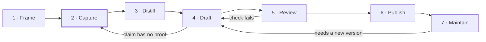

# The documentation lifecycle

Every project runs through seven phases, and the writeup is assembled during them rather than reconstructed afterward. Capture is highlighted because every later phase can only use what you recorded.

Two loops are normal. A failed review check sends the piece back to Draft, and a claim with no proof sends you back to Capture or gets cut. Maintenance reopens Draft whenever a piece needs a new version.

| Phase | Leave the phase when | Template |
| --- | --- | --- |
| 1 · Frame | The kickoff card is filled: goal, reader, done criteria, scope, baseline | [Kickoff card](../templates/01-kickoff-card.md) |
| 2 · Capture | The work is done and every result has a PROOF line | [Running log](../templates/02-running-log.md), [decision record](../templates/03-decision-record.md) |
| 3 · Distill | You have an outline, a retro and your 3 to 5 strongest pieces of evidence | [Retrospective prompts](../templates/06-retrospective-and-brag-doc-entry.md) |
| 4 · Draft | Every master-template section is filled or deliberately cut | [Master writeup](../templates/04-master-writeup.md) |
| 5 · Review | The quality-bar checklist passes | [Quality bar](09-quality-bar.md) |
| 6 · Publish | Card, summary, writeup and repo exist and link to each other | [Short forms](../templates/05-short-forms.md) |
| 7 · Maintain | Never; re-check on a schedule, at least yearly | Changelog line |

Small projects compress the phases; they do not skip them. A one-hour lab can frame and distill in a few minutes each.
